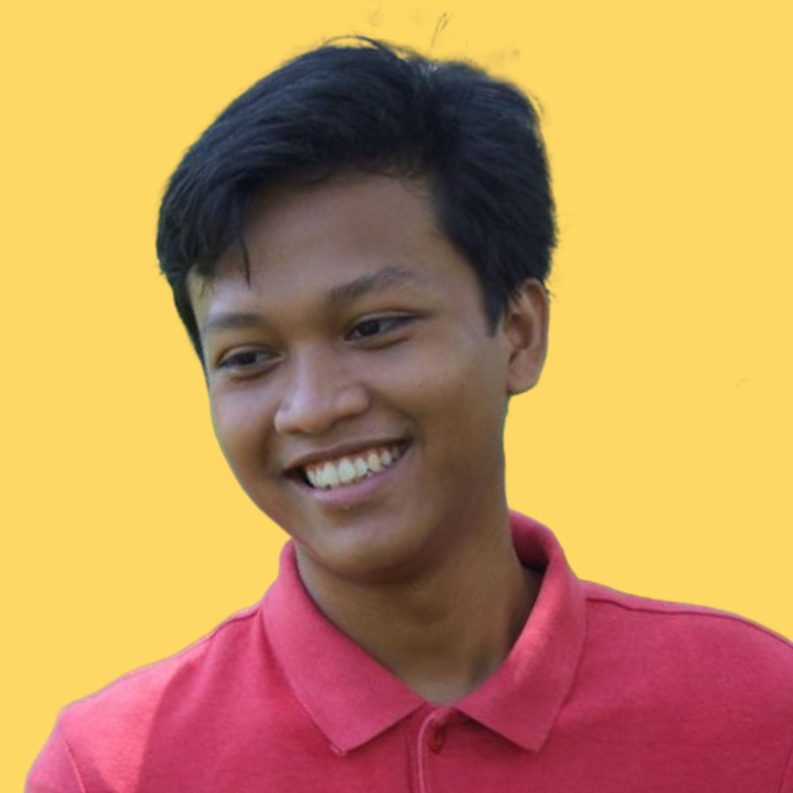
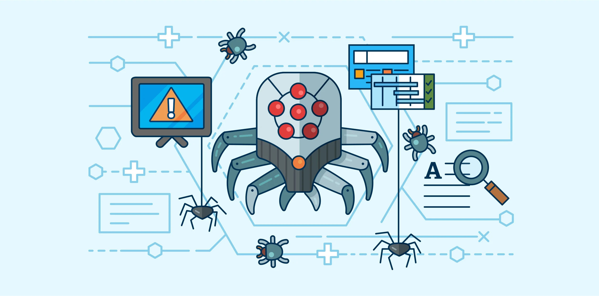
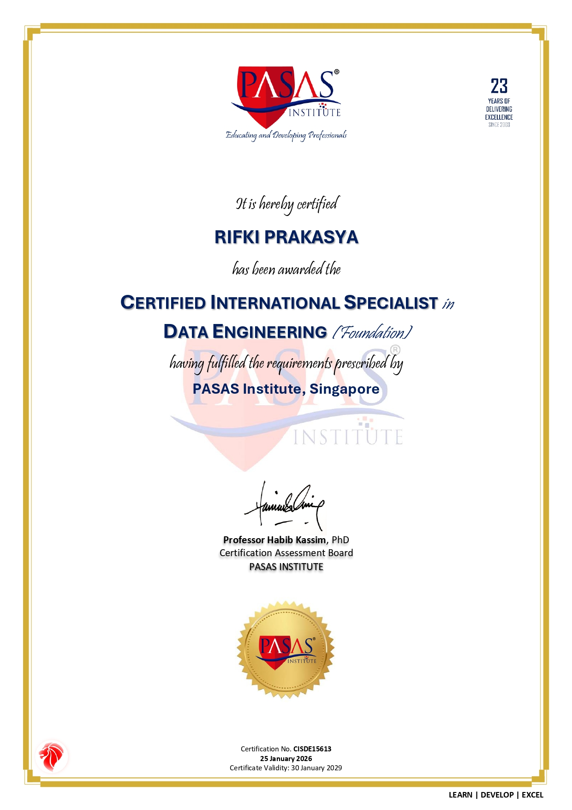
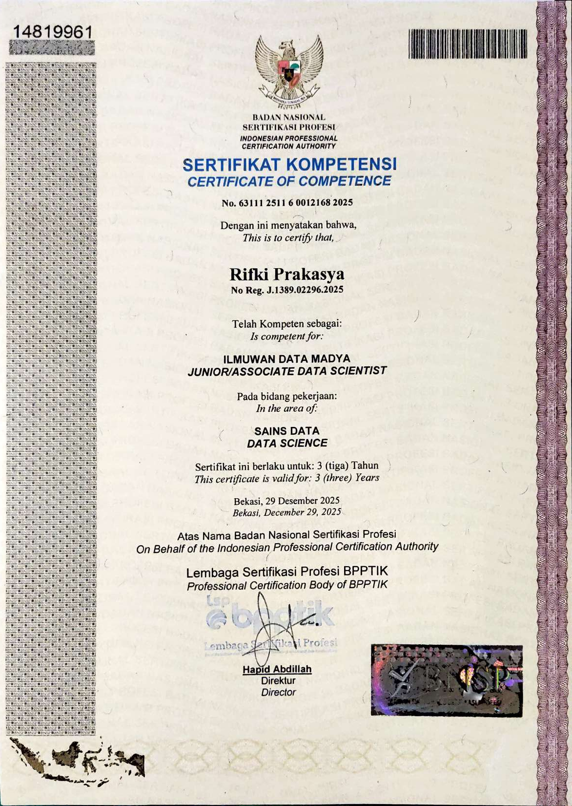
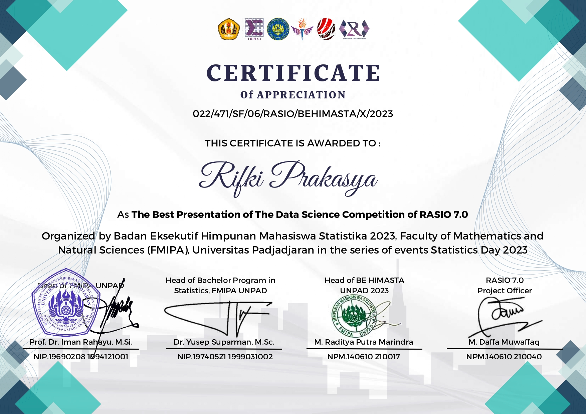

  

::: {.d-flex .justify-content-center}
[<i class="bi bi-download"></i> Download My CV](https://drive.google.com/file/d/1JYzaLNgqFFamS-uiX3NzcSKLf-pTBxNC/view?usp=drive_link){.btn .btn-outline-secondary role="button" target="_blank"} [<i class="bi bi-envelope"></i> Email](mailto:rifki.prakasya@gmail.com){.btn .btn-outline-danger role="button" target="_blank"} [<i class="bi bi-github"></i> GitHub](https://github.com/RubikRif){.btn .btn-outline-dark role="button" target="_blank"} [<i class="bi bi-linkedin"></i> LinkedIn](https://www.linkedin.com/in/rifki-prakasya){.btn .btn-outline-info role="button" target="_blank"} [<i class="bi bi-whatsapp"></i> WhatsApp](https://wa.me/6285719708422){.btn .btn-outline-success role="button" target="_blank"}
:::

I am a Mathematics graduate of Universitas Indonesia with a 6-month internship as an AI Engineer Intern at the Ministry of Communication and Digital, covering structured data extraction with LLM APIs, crawler-scraper development, and collection of 13M+ tokens of text for an Indonesian-language LLM corpus. Experienced in building IndoBERT-based NLP models (83% accuracy on sentiment analysis) and in teaching machine learning and deep learning as a computer lab assistant. Seeking an AI Engineer / Data Scientist role to build data and LLM-driven solutions.

---

## 🎯 My Interests

::: {.grid}

::: {.g-col-12 .g-col-md-4}
::: {.card .mb-3 .h-100 .shadow-sm .text-center}
::: {.card-header}
##### 🧠 **Artificial Intelligence**
:::
::: {.card-body}
Python

Implementing Machine Learning, Deep Learning, Natural Language Processing, and Large Language Models to solve business problems.
:::
::: {.card-footer .bg-light}
[View All Projects](projects/ai/index.qmd){.stretched-link}
:::
:::
:::

::: {.g-col-12 .g-col-md-4}
::: {.card .mb-3 .h-100 .shadow-sm .text-center}
::: {.card-header}
##### 🤖 **Automation**
:::
::: {.card-body}
Python

Developing an effective automation system for repetitive tasks.
:::
::: {.card-footer .bg-light}
[View All Projects](projects/auto/index.qmd){.stretched-link}
:::
:::
:::

::: {.g-col-12 .g-col-md-4}
::: {.card .mb-3 .h-100 .shadow-sm .text-center}
::: {.card-header}
##### 📊 **Data Analytics**
:::
::: {.card-body}
Excel PowerBI SQL

Querying, manipulating complex data, and building interactive dashboards to create actionable insights.
:::
::: {.card-footer .bg-light}
[View All Projects](projects/da/index.qmd){.stretched-link}
:::
:::
:::

:::

## 🗂️ Highlighted Projects

::: {.grid}

::: {.g-col-12 .g-col-md-4}
::: {.card .mb-3 .h-100 .shadow-sm .text-center}

::: {.card-body .d-flex .flex-column}
{style="height: 200px; object-fit: contain;"}

**Topic-Level Sentiment Analysis of Shopee App User Reviews on Google Play**
:::

::: {.card-footer .bg-light}
[View Project](projects/ai/shopee.ipynb){.stretched-link}
:::

:::
:::

::: {.g-col-12 .g-col-md-4}
::: {.card .mb-3 .h-100 .shadow-sm .text-center}

::: {.card-body .d-flex .flex-column}
{style="height: 200px; object-fit: contain;"}

**Healthy Spiders: Crawler-Scraper for Indonesian Health Domain Websites**
:::

::: {.card-footer .bg-light}
[View Project](projects/auto/healthy-spiders.qmd){.stretched-link}
:::

:::
:::

::: {.g-col-12 .g-col-md-4}
::: {.card .mb-3 .h-100 .shadow-sm .text-center}

::: {.card-body .d-flex .flex-column}
{style="height: 200px; object-fit: contain;"}

**Online Pet Supply Store Analysis**
:::

::: {.card-footer .bg-light}
[View Project](projects/da/online-pet-supply-store.qmd){.stretched-link}
:::

:::
:::

:::

## 🎓 Education

<table class="table table-hover align-middle">
  <thead>
    <tr>
      <th scope="col" class="text-start">Universitas Indonesia | Depok, Indonesia</th>
      <th scope="col" class="text-end">Aug 2021—July 2025</th>
    </tr>
  </thead>
</table>

Undergraduate Study Program of Mathematics

* GPA: 3.81/4.00

* Relevant Coursework: Algorithm and Programming, Linear Algebra, Calculus, Mathematical Statistics, Data Structure,
Data Science, Operational Research, Web Mining.

## 💼 Work Experience

<table class="table table-hover align-middle">
  <thead>
    <tr>
      <th scope="col" class="text-start">AI Engineer | Pusbang Talenta Digital, Ministry of Communication and Digital RI</th>
      <th scope="col" class="text-end">Nov 2025—May 2026</th>
    </tr>
  </thead>
</table>

Internship

* Designed and built crawler-scraper for Indonesian health domain websites; successfully collected 13 million$+$ tokens over 5 supported websites in approximately 2.5 hours for Indonesian LLM Continued Pre-Training corpus implementing asynchronous processing, random batching with SQLite-based URL management, request delays, logging, curl_cffi, BeautifulSoup, markdownify, and regex-based text cleaning.

<table class="table table-hover align-middle">
  <thead>
    <tr>
      <th scope="col" class="text-start">Computer Lab Assistant | Department of Mathematics, UI</th>
      <th scope="col" class="text-end">Aug 2023—Dec 2024</th>
    </tr>
  </thead>
</table>

Part-time

* Delivered weekly practicum session about algorithm and programming fundamentals in Python and hands-on machine learning and deep learning study using Scikit-Learn, TensorFlow/Keras, and Pytorch to ±40 students per session, covering data preparation, model training, and model evaluation for regression, classification, and clustering tasks.

<table class="table table-hover align-middle">
  <thead>
    <tr>
      <th scope="col" class="text-start">Teaching Assistant | Department of Mathematics, UI</th>
      <th scope="col" class="text-end">Aug 2023—Dec 2023</th>
    </tr>
  </thead>
</table>

Part-time

* Conducted 6x2-hours tutorial sessions and provided responsive academic assistance outside of tutorial sessions for approximately 40 students on Real Analysis topics, including supremum/infimum, completeness of the real numbers, limits of sequences and functions, and continuity of functions.

## 👥 Organizational and Volunteering Experiences

<table class="table table-hover align-middle">
  <thead>
    <tr>
      <th scope="col" class="text-start">LOGIKA UI 2024 | Depok, Indonesia</th>
      <th scope="col" class="text-end">Aug 2023—Feb 2024</th>
    </tr>
  </thead>
</table>

Staff of Registration Division

* Managed and compiled approximately 200 registration records on a division's weekly schedule to ensure accuracy and completeness.

<table class="table table-hover align-middle">
  <thead>
    <tr>
      <th scope="col" class="text-start">PRISMA X | Depok, Indonesia</th>
      <th scope="col" class="text-end">Jul 2022—Nov 2022</th>
    </tr>
  </thead>
</table>

Deputy Coordinator of Documentation and Design Division

* Co-led 4 staff members to manage design themes, task allocation, publication workflows, and event documentation; arranged 18 design needs, producing 100$+$ digital visual assets (Instagram feeds, Instagram stories, Zoom backgrounds), merchandise, and committee uniform shirts.

<table class="table table-hover align-middle">
  <thead>
    <tr>
      <th scope="col" class="text-start">HMD Matematika FMIPA UI | Depok, Indonesia</th>
      <th scope="col" class="text-end">Mar 2022—Feb 2023</th>
    </tr>
  </thead>
</table>

Staff of Multimedia, Entertainment, and Design Bureau

* Served as the dedicated designer for Fundraising (FUNGSI) Bureau and Exploration, Regeneration, and Internal (EXPONENT) Bureau; produced 53 designs, including Instagram feeds and stories for fundraising product catalogs, open recruitment posts, and a jacket mockup.

## 📜 Certifications, Achievements, and Awards

::: {.grid}

::: {.g-col-12 .g-col-md-4}
::: {.card .mb-3 .h-100 .shadow-sm .text-center}

::: {.card-body .d-flex .flex-column}
{style="height: 200px; object-fit: contain;"}

**Certified International Specialist in Data Engineering (Foundation)**
:::

::: {.card-footer .bg-light}
Jan 2026—Jan 2029
{.stretched-link target="_blank"}
:::

:::
:::

::: {.g-col-12 .g-col-md-4}
::: {.card .mb-3 .h-100 .shadow-sm .text-center}

::: {.card-body .d-flex .flex-column}
{style="height: 200px; object-fit: contain;"}

**Associate Data Scientist**
:::

::: {.card-footer .bg-light}
Dec 2025—Dec 2028
{.stretched-link target="_blank"}
:::

:::
:::

::: {.g-col-12 .g-col-md-4}
::: {.card .mb-3 .h-100 .shadow-sm .text-center}

::: {.card-body .d-flex .flex-column}
{style="height: 200px; object-fit: contain;"}

**The Best Presentation of The Data Science Competition of RASIO 7.0**
:::

::: {.card-footer .bg-light}
Oct 2023
{.stretched-link target="_blank"}
:::

:::
:::

:::

---

This is a Quarto website.

To learn more about Quarto websites visit [https://quarto.org/docs/websites](https://quarto.org/docs/websites){target="_blank"}.
