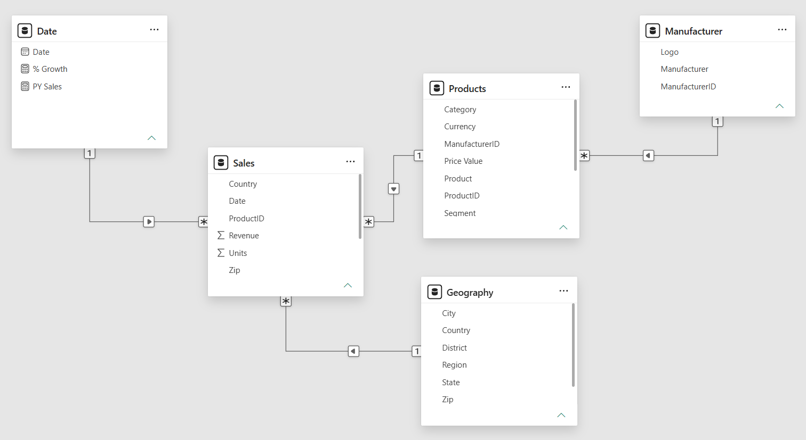

<ol class="breadcrumb">
  <li class="breadcrumb-item"><a href="../../home.qmd">Home</a></li>
  <li class="breadcrumb-item"><a href="../da/index.qmd">Data Analytics Projects</a></li>
  <li class="breadcrumb-item active">Competitor Sales Analysis</li>
</ol>

## Overview

The core goal of this project is to build a dashboard using a fictional Sales and Market share dataset for a manufacturing company called Sintec. Sintec is looking for a solution to focus on the following objectives:

- The company's performance internally on how well their products sell.

- Analyze other top competitors' sales.

- How well they are performing against the other competitors' products.

### Dataset

In this project, we'll work with **snowflake-based schema** which consists of a fact table and dimension tables. 

The transactional data is spread across six countries in one folder, and USA's data is in a separate folder. So we are going to work with **one fact table that will be created through the transformations step by combining multiple files**. The final fact table stores all the transactional data: date, zip code, product units, revenue, and country.

In addition, we'll be working with **4 dimension tables**: 

- **Geography table** having city, state, and zip details. 

- **Product table** comprising of products data along with their price. 

- **Manufacturer table** contains the manufacturer's information, and the Date table. 

- **Date table** will be created using DAX calculations during the case study.

[<i class="bi bi-download"></i> Download Datasets (.zip)](data/competitor-sales.zip){.btn .btn-secondary role="button" download="" target="_blank}

[See Metadata](https://docs.google.com/spreadsheets/d/19_fCRmKK1Vgbv2WdOWj_zsuj09zrtJ63foku7vOaTkQ/edit?usp=sharing){.btn .btn-outline-success role="button" target="_blank}

### Tools & Technologies

- Microsoft PowerBI

- Power Query

- DAX 

- Data Modeling

## Data Preparation

**Data Transformation using Power Query**

## Dashboard

[Download Dashboard (.pbix)](dashboard/competitor-sales-analysis.pbix){.btn .btn-warning role="button" download="" target="_blank}

## Key Findings