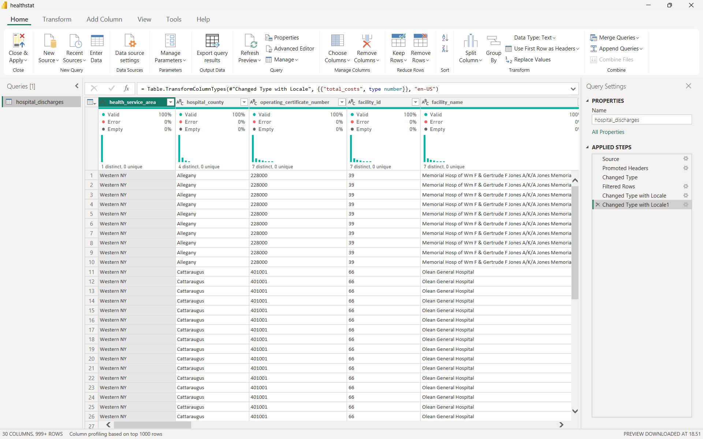
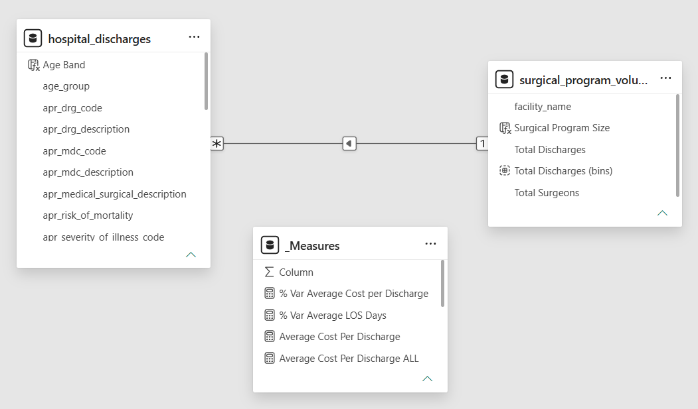
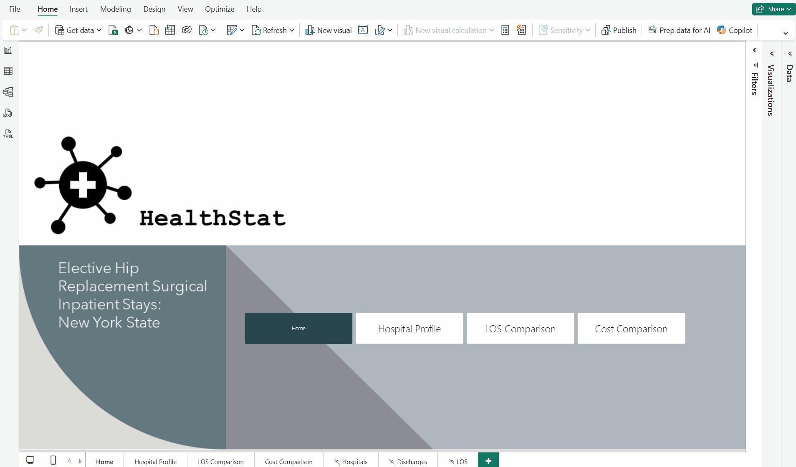

<ol class="breadcrumb">
  <li class="breadcrumb-item"><a href="../../index.qmd">Home</a></li>
  <li class="breadcrumb-item"><a href="../da/index.qmd">Data Analytics Projects</a></li>
  <li class="breadcrumb-item active">Analyzing Healthcare Data</li>
</ol>

## Overview

In this project, a fictitious consulting company called HealthStat wants to uncover insights on potential hospital efficiency opportunities. 

First, there are some terms that we need to know:

- **Discharge** is defined as the release of a patient from hospital care by a medical worker. 

- **Disposition** is the patient destination or status upon discharge, for instance to another facility or to home. 

- **Elective surgery** is a procedure that was planned in advance, in other words, it was not due to an emergency.

Then, when measuring a hospital efficiency, it is important to know one important indicator, namely Length of Stay.

**Length of Stay (LOS)** is calculated as the total duration in days for a patient stay in hospital. A shorter LOS is often desirable in hospital operations. Primarily, **shorter LOS means costs can be lowered**, release capacity in the system, and improve throughput, enabling hospitals to serve more patients. Many factors can impact LOS.

In this project, the **focus** is **on patients who received hip replacement surgery**. Patients with hip pain, typically arthritis, may require elective hip replacement surgery. In this procedure, damaged bone and cartilage is surgically removed and replaced with prosthetic components. Hospital stay can range from 0 to 2 or more days.

This project presents an interactive dashboard that enables stakeholders to: Progress through key insights in a logical flow, View informative, concise visuals Get data they need to make business decisions for improving efficiency.

### Dataset

For this project, we will be working with a single dataset that includes New York state-wide hospital discharge data for a year (2016). Elective hip replacement surgery was the main reason for their hospital stay. The dataset is one single table with 30 columns Each row in the dataset represents a single inpatient stay, from their admission to discharge date. The health information in this dataset is not individually identifiable. This means the file does not contain personal health information.

[<i class="bi bi-download"></i> Download Dataset (.csv)](data/hospital.csv){.btn .btn-secondary role="button" download="" target="_blank}

[See Metadata](https://docs.google.com/spreadsheets/d/12obAfLNTPSGtM9gGsiTSWn2eRN5EnQH17WlG7qXCXtI/edit?usp=sharing){.btn .btn-outline-success role="button" target="_blank}

### Tools & Technologies

- Microsoft PowerBI

- Power Query

- DAX 

- Data Modeling

## Data Preparation

### Data Cleaning and Transformation using Power Query

The raw hospital records were preprocessed and filtered to isolate a specific high-impact surgical cohort:

**Hospital Discharges Table (`hospital_discharges`)**:
* Promoted the first row to headers for proper schema structuring.

* Filtered dataset rows strictly for hip surgery procedures where `ccs_procedure_description = "HIP REPLACEMENT,TOT/PRT"` to maintain a focused clinical benchmark.

* Cast `length_of_stay` to Integer for accurate day-count aggregations.

* Transformed financial metrics (`total_charges` and `total_costs`) to Decimal data types using `Indonesian` locale formatting to prevent parsing errors.

### Calculated Columns and Table Summarization using DAX

To segment patient demographics and categorize hospital surgical volumes, custom calculated columns and summarized tables were constructed:

* **Demographic Segmentation (`Age Band`)**:

  Created a conditional calculated column on the **`hospital_discharges` table** to group adult cohorts:
  $$\text{Age Band} = \begin{cases} \text{"Age 50+"} & \text{if } \text{age\_group} \in \{\text{"50 to 69"},\text{"70 or Older"}\} \\ 
  \text{"Age <50"} & \text{otherwise} \end{cases}$$

* **Surgical Program Volume Summary Table (`surgical_program_volume_summary`)**:

  * Generated a summary table aggregating facility workloads using `SUMMARIZECOLUMNS`:
    $$
    \begin{aligned}
    \text{surgical\_program\_volume\_summary} = \; & \text{SUMMARIZECOLUMNS}( \\
    & \quad \text{hospital\_discharges[facility\_name]}, \\
    & \quad \text{"Total Discharges"}, [\text{Total Discharges}], \\
    & \quad \text{"Total Surgeons"}, [\text{Total Surgeons}] \\
    )
    \end{aligned}
    $$

  * Established a **bins grouping** on `Total Discharges` with a bin size of $200$.

  * Added a calculated column `Surgical Program Size` using a `SWITCH` statement to classify hospital scales into operational tiers (`<200`, `200-399`, `400-599`, `>600`).

  * Linked the summary table back to the primary `hospital_discharges` table via a many-to-one relationship on `facility_name`.

### Data Modeling

### Key Measures and Dynamic Metrics using DAX

Analytical measures were established to evaluate throughput, length of stay (LOS), cost efficiency, and variance against overall system benchmarks:

* **Core Operational Metrics**:

  * $\text{Total Discharges} = \text{COUNT}(\text{discharge\_year})$

  * $\text{Total Hospitals} = \text{DISTINCTCOUNT}(\text{facility\_id})$

  * $\text{Total Surgeons} = \text{DISTINCTCOUNT}(\text{operating\_provider\_license\_number})$

* **Length of Stay & Cost Performance**:

  * $\text{Average LOS Days} = \text{AVERAGE}(\text{length\_of\_stay})$

  * $\text{Average Cost Per Discharge} = \frac{\sum\text{total\_costs}}{\text{Total Discharges}}$

* **Benchmark Variance Measures (ALL Function Context)**:

  * $\text{Average LOS Days ALL} = \text{CALCULATE}([\text{Average LOS Days}], \text{ALL}())$

  * $\text{Average Cost Per Discharge ALL} = \text{CALCULATE}([\text{Average Cost Per Discharge}], \text{ALL}())$

  * $\% \text{ Var Average LOS Days} = \frac{[\text{Average LOS Days}] - [\text{Average LOS Days ALL}]}{[\text{Average LOS Days ALL}]}$

  * $\% \text{ Var Average Cost per Discharge} = \frac{[\text{Average Cost Per Discharge}] - [\text{Average Cost Per Discharge ALL}]}{[\text{Average Cost Per Discharge ALL}]}$

## Dashboard

[<i class="bi bi-download"></i> Download Dashboard (.pbix)](dashboard/healthstat.pbix){.btn .btn-warning role="button" download="" target="_blank}

## Key Insights and Recommendations

### A. Macro Operational Benchmarks

Across the state-level dataset comprising **151 hospitals** and **26,286 patient discharges**:

* **Average LOS**: **$2.65$ days** per patient stay.

* **Average Cost per Discharge**: **$\$21\text{K}$** per patient.

* **Hospital Profile Benchmark (Case Study: University Hospital)**:

  * Demonstrates above-average efficiency with an **Average LOS of $2.56$ days** (below the $2.65$-day benchmark).

  * Maintains lower operational expenses at **$\$17\text{K}$ per discharge** (compared to the $\$21\text{K}$ system average).

  * Patient demographic skew: Primarily handles **Moderate** severity of illness and **Minor** risk of mortality cohorts.

### B. Key Drivers of Extended Length of Stay (LOS)

Statistical Key Influencer analysis isolates the clinical and operational drivers that significantly expand patient LOS:

1. **Illness Severity (`apr_severity_of_illness`)**:

   * Patients classified under **Extreme Severity** increase average stay duration by **$+8.96$ days**.

2. **Mortality Risk (`apr_risk_of_mortality`)**:

   * **Extreme Risk**: Increases LOS by **$+6.09$ days**.

   * **Major Risk**: Increases LOS by **$+2.48$ days**.

3. **Post-Discharge Disposition Bottlenecks**:

   * Referrals to **Skilled Nursing Homes** extend LOS by **$+1.29$ days**, signaling systemic delays in post-acute care placement and transfer coordination.

4. **Geographic Impact**:

   * Facilities in the **New York City** service area experience an average LOS increase of **$+1.68$ days** compared to other regions.

### C. Financial Impact & Hospital Outliers (LOS vs. Cost Correlation)

Cross-evaluating LOS against financial outcomes reveals a strong positive correlation where prolonged stays exponentially escalate healthcare delivery costs.

* **Cost Drivers**: Extreme severity adds an average of **$+\$37.3\text{K}$** to total discharge cost, while extreme mortality risk adds **$+\$24.25\text{K}$**. Also, NYC Region Facility location adds cost escalation **$+\$15.04\text{K}$** per discharge.

* **Facility Outliers**:

  * **Highest Cost Centers**: *NYU Lutheran Medical Center* ($\$85\text{K}$ avg cost), *Olean General Hospital* ($\$81\text{K}$), and *Memorial Hospital for Cancer* ($\$64\text{K}$).

  * **Highest LOS Outliers**: *Kings County Hospital Center* leads with an average LOS of **$12$ days**, followed by *Interfaith Medical Center* and *Memorial Hospital for Cancer* (**$9$ days**).

  * **Top Efficiency Leader**: *Northern Dutchess Hospital* achieves an industry-leading average LOS of just **$1.4$ days**.

### Strategic Recommendations

To optimize bed turnover rate, lower per-patient operational expenses, and expand capacity, here are recommendations for targeted interventions:

1. **Early Discharge & Post-Acute Care Coordination**:
   * Address the **$+1.29$-day delay** associated with *Skilled Nursing Home* transfers by instituting **Day-1 Discharge Planning**. Pre-coordinating post-acute bed availability upon patient admission will minimize non-clinical administrative delays.

2. **High-Severity Clinical Pathways**:
   * Establish standardized multidisciplinary protocols specifically for *Extreme Severity* cohorts. Proactive daily case reviews can mitigate complication risks that drive severe cost overruns ($+\$37.3\text{K}$ per case).

3. **Cross-Facility Operational Benchmarking**:
   * Conduct operational audits at high-LOS facilities (e.g., *Kings County Hospital* at $12$ days) to adopt patient-flow practices from high-efficiency performers like *Northern Dutchess Hospital* ($1.4$ days).

4. **System Capacity Expansion via Efficiency**:
   * Reducing average system LOS toward a $2.0$-day target across mid-tier hospitals releases existing bed capacity without expanding physical infrastructure, enabling facilities to accommodate higher surgical patient throughput.