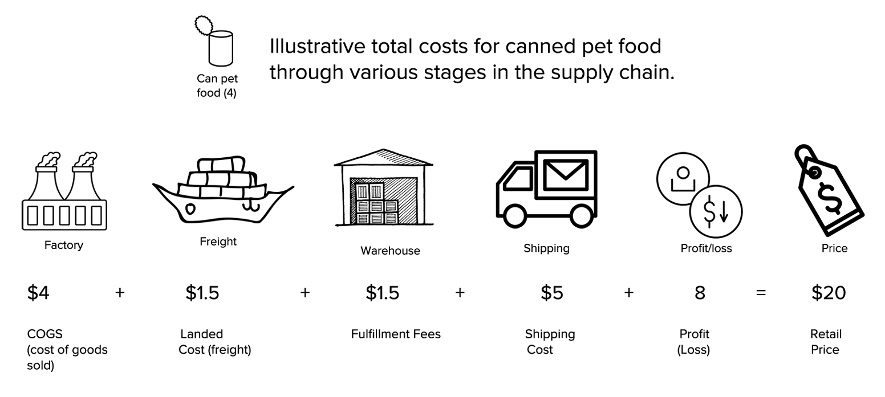
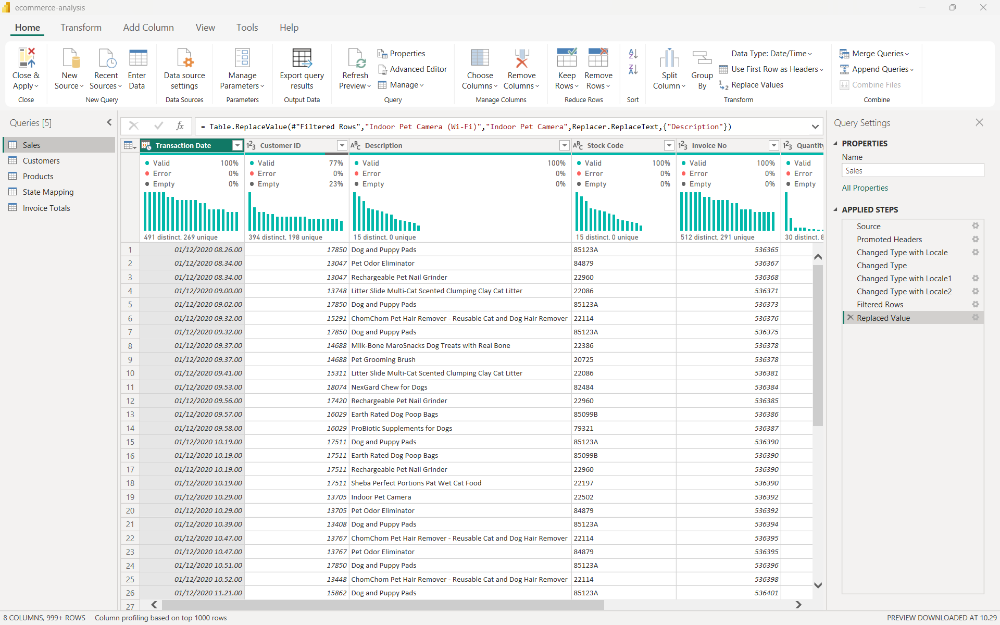
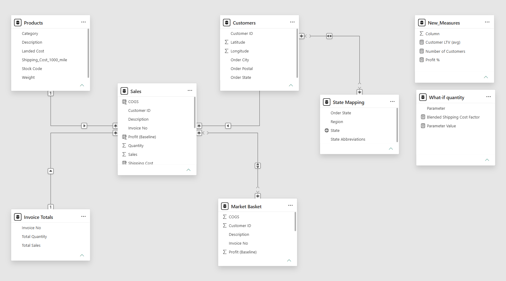
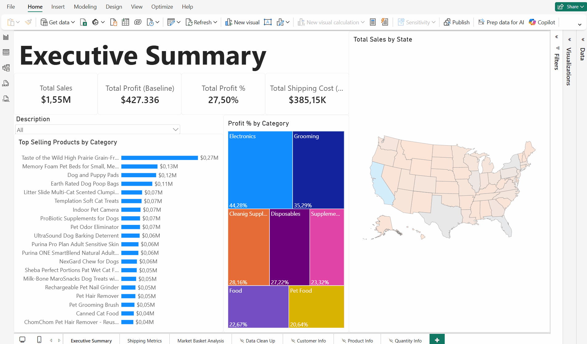

<ol class="breadcrumb">
  <li class="breadcrumb-item"><a href="../../home.qmd">Home</a></li>
  <li class="breadcrumb-item"><a href="../da/index.qmd">Data Analytics Projects</a></li>
  <li class="breadcrumb-item active">Online Pet Supply Store Analysis</li>
</ol>

## Overview

In this project, we'll work with a fictitious dataset from an online pet supply company called Whiskique, to uncover insights into the company's overall performance and possible improvement opportunities. Firstly, we will examine some important terms and operations involved in ecommerce businesses.

Let's look at an illustrative example of the total costs for canned pet food through various stages in the supply chain. 



In this example, for a $20 purchase of canned pet food, $4 goes to the manufacturer. This is also called the cost of goods sold or COGS. one dollar and 50 cents is spent on freight costs and fulfillment fees. This includes the cost to ship a product from the manufacturer to the warehouse and the warehouse storage fees. Last-mile delivery to customers costs $5. This leaves a profit markup of $8 before administrative costs.

Whiskique pet supply has **two primary business goals**. 

1. The first is to **serve as many customers as possible and increase sales**. 

2. The second is to **reduce its operating expenses**.

For sales growth, we can focus on upsell and cross-sell opportunities. In a cross-sell, we promote a relevant product at the point of purchase. For example, when a customer is ready to buy a beach umbrella, present an offer on beach chairs. We can implement a **market basket analysis** that aims to find products frequently bought together in a single checkout. Meanwhile in an upsell, we promote a higher-priced alternative or a higher quantity of a product. For example, when a customer buys pet food regularly, present an offer on organic food.

For shipping cost reductions, we can explore some of the following alternatives. Consolidating multiple shipments into a single one. Reducing package size dimensions and weight. And, finally, shipping a higher quantity of a product.

### Dataset

The data consists of **four CSV files**:

- The **sales table** is the primary transaction table or the *fact table*. 

- The **product table** and **customer table** contain additional attributes. The **state mapping** has consistent values for locations. These tables are called *dimension tables*.

[<i class="bi bi-download"></i> Download Datasets (.zip)](data/online-pet-supply-store.zip){.btn .btn-secondary role="button" download="" target="_blank}

[See Metadata](https://docs.google.com/spreadsheets/d/1FbMaqOgVeZrt61TnYkdA88lNTxf5HSC1A1tdCVVt-00/edit?usp=sharing){.btn .btn-outline-success role="button" target="_blank}

### Tools & Technologies

- Microsoft PowerBI

- Power Query

- DAX 

- Data Modeling

## Data Preparation

### Data Cleaning and Transformation using Power Query



Data cleaning and transformation were applied across multiple transactional and lookup tables to standardize types and fix locale formatting issues:

* **Sales Table**:

  * Promoted first row to headers and filtered out invalid transactions (`Invoice No` is not null).

  * Adjusted `Transaction Date` to `Date` using `English (US)` locale to resolve date parsing errors.

  * Standardized `Sales` and `Unit Price` to `Decimal` using `Indonesian` locale to accurately capture fractional values.

  * Standardized product naming consistency (e.g., replaced `"indoor pet camera (wi-fi)"` with `"indoor pet camera"`).

* **Customers & Products Tables**:

  * Promoted headers and cast operational IDs (`Customer ID`) to Integer.

  * Transformed numeric metrics (`Latitude`, `Longitude`, `Weight`, `Landed Cost`, `Shipping_Cost_1000_mile`) to `Decimal` with proper local parsing.

* **State Mapping**: Cleaned and promoted headers for spatial analysis.

* **Invoice Totals Table (Aggregated Table)**:

  * Duplicated the `Sales` table to form an aggregated table grouped by `Invoice No`.

  * Computed invoice-level aggregations: `SUM(Quantity)` and `SUM(Sales)`.

### Data Modeling

A **Star Schema** architecture was established to maintain high DAX query performance and support Market Basket Analysis:

* **Primary Relationships**: Star schema connecting `Sales` (Fact) to `Customers`, `Products`, and `State Mapping` (Dimensions).

* **Market Basket Analysis Table**: Created a duplicated table `Market Basket = Sales` connected to the main `Sales` table via `Invoice No` (Many-to-Many / Single-direction filtering) to analyze cross-selling product co-occurrences within the same checkout.



### Key Measures and What-If Simulation Logic

Instead of static calculations, dynamic DAX measures and What-If parameters were implemented to evaluate business goals (Sales Growth & Shipping Efficiency).

#### A. Core Business Metrics

* **Customer Lifetime Value (LTV)**: Evaluates average revenue contribution per customer.
  $$\text{Customer LTV (Avg)} = \frac{\sum\text{Sales}}{\text{Number of Unique Customers}}$$

* **Profit Baseline %**: Measures baseline margin before operational optimization.
  $$\text{Profit \%} = \frac{\sum\text{Profit (Baseline)}}{\sum\text{Sales}}$$

#### B. Dynamic Shipping Cost and What-If Simulation Logic

To quantify potential cost savings from bulk shipment consolidation, a **What-If Parameter** (`What-if quantity`: range 1 to 20) was introduced. 

The baseline shipping model charges 100% shipping cost for the first item and applies a fixed 30% discount (0.7 factor) for additional items. The What-If scenario dynamically replaces this factor using tiered volume discounts:

$$\text{Blended Shipping Cost Factor} = 
\begin{cases} 
1.0 & \text{if } Q \le 1 \\
0.8 & \text{if } Q \le 2 \\
0.6 & \text{if } Q \le 4 \\
0.5 & \text{if } Q \le 7 \\
0.4 & \text{if } Q \le 9 \\
0.3 & \text{if } Q > 9 
\end{cases}$$

**Key DAX Formulation Highlight:**

```dax
// Baseline Shipping Cost (Fixed 70% cost for additional units)
Shipping (Baseline) = 
SUMX(
    Sales, 
    IF(
        Sales[Quantity] = 1, 
        Sales[Shipping Cost], 
        Sales[Shipping Cost] + ((Sales[Quantity] - 1) * (Sales[Shipping Cost] * 0.7))
    )
)

// What-If Shipping Cost (Dynamic factor based on order volume)
Shipping (What-if) = 
SUMX(
    Sales, 
    IF(
        Sales[Quantity] = 1, 
        Sales[Shipping Cost], 
        Sales[Shipping Cost] + ((Sales[Quantity] - 1) * (Sales[Shipping Cost] * 'What-if quantity'[Blended Shipping Cost Factor]))
    )
)

// Total Operational Cost Savings
Shipping (Difference) = [Shipping (Baseline)] - [Shipping (What-if)]
```

## Dashboard



[Download Dashboard (.pbix)](dashboard/ecommerce-analysis.pbix){.btn .btn-warning role="button" download="" target="_blank}

## Key Insights and Recommendations

### Executive Summary

* Key Financial Performance: Total sales reached $1.55M with a baseline profit of $427,336 (profit margin of 27.50%).   

* Most Profitable Categories: The Electronics (44.28%) and Grooming (35.29%) categories generate the highest profit margins, while Pet Food (20.64%) and Food (22.67%) have lower profit margins.

* Operational Challenges: Total shipping costs are quite high, at $385,15K, or approximately 24.8% of total revenue. This significantly erodes the profit margin. 

Moreover, based on the Power BI dashboard analysis, strategic insights were derived to address Whiskique’s 2 core business goals: **increase salses** through targeted cross-selling and upselling strategy and **shipping cost reductions** via logistics optimization.

### Goal 1: Increase Sales

Market Basket Analysis on co-occurrence patterns across transaction checkouts revealed clear product associations:

* **Primary Anchor Product**: *Memory Foam Pet Beds* serves as the strongest catalyst for cross-category purchases.

* **Top Basket Pairings**: Customers buying pet beds frequently add high-volume consumables to the same invoice:

  * **Pet Food**: *Purina ONE SmartBlend* (487 co-purchases) and *Taste of the Wild* (404 co-purchases).

  * **Hygiene Essentials**: *Dog & Puppy Pads* (396 co-purchases) and *Earth Rated Dog Poop Bags* (331 co-purchases).

* **High-Margin Attach Opportunities**: Products in **Electronics** (e.g., *Indoor Pet Camera*) and **Grooming** (e.g., *ChomChom Pet Hair Remover*) yield top-tier profit margins ($44.28\%$ and $35.29\%$, respectively), despite lower overall sales volume.

#### Strategic Recommendations

1. **Checkout Bundling ("Starter Kits")**: Implement automated checkout prompts offering a $5\text{--}10\%$ bundle discount on *Pet Bed + Puppy Pads + Poop Bags*.

2. **Margin-Driven Upselling**: Trigger smart recommendations for high-margin accessories (*Indoor Pet Camera* or *ChomChom Pet Hair Remover*) whenever a customer adds routine pet food to their cart.

### Goal 2: Shipping Cost Reductions

Baseline logistics expenses totaled **$\$385.15\text{K}$**, representing approximately **$24.8\%$ of total gross sales** ($\$1.55\text{M}$).

* **What-If Simulation Impact**: By shifting average unit order quantities toward bulk purchases (simulated at $Q = 11$, reducing the blended shipping factor to $0.30$), total shipping expenses drop to **$\$266.96\text{K}$**.

* **Net Profit Realization**: Operational cost reduction yields an immediate **$\$118.19\text{K}$ in bottom-line savings** (~$30.6\%$ reduction in logisitics costs).

* **Category Volume Disparities**: *Pet Food* leads in average shipped quantity per transaction ($5.31$ units), whereas *Electronics* ($1.38$ units) and *Supplements* ($2.36$ units) suffer from fragmented single-unit shipments.

#### Strategic Recommendations

1. **Tiered Free-Shipping Thresholds**: Replace flat-rate shipping with volume-based incentives (e.g., *"Order 3+ items to qualify for free shipping"*), incentivizing multi-item cart consolidation.

2. **"Subscribe & Save" Program**: Introduce recurring bulk subscriptions for high-frequency categories (*Pet Food* & *Supplies*) to enable batch shipping fulfillment from regional centers (e.g., Texas and Central regional hubs).